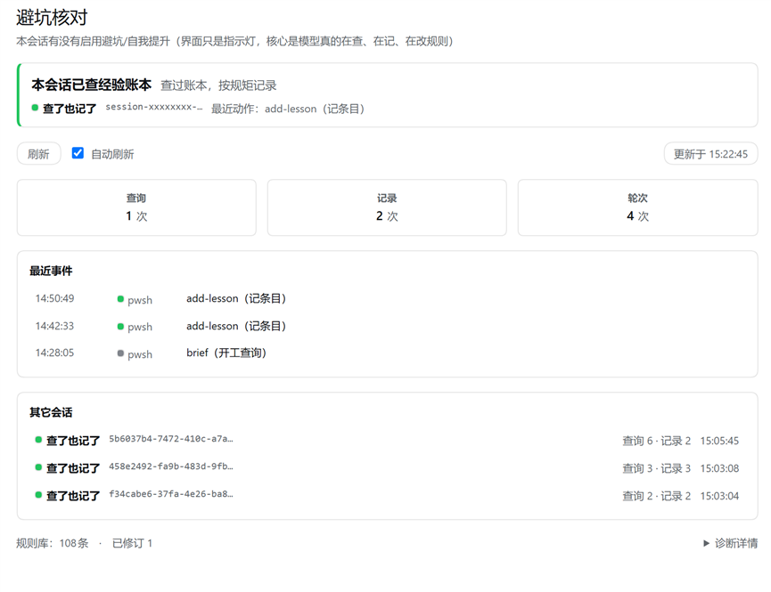

# dsh-ledger-watch · 避坑核对

**目的**：让模型**真的**在查经验账本、记下踩过的坑、修正失效的规则 —— 也就是自我提升 / 自我避坑 / 自我升级。
**界面只是指示灯**：显示「当前会话有没有启用这个避坑/提升功能」，以及规则库的健康度。

它**不是**审计系统，**不是**监控用户行为的工具，也**不生产规则**（规则由 `lesson-ledger` 账本生产）。



> 上图是真实运行界面（会话 id 与证据文件路径已替换为占位符）：顶部一行是**启用指示灯**（本会话有没有查经验账本），下面是结论条、本会话指标、事件时间线，页脚是规则库健康度与召回状态。

<details>
<summary><b>English summary</b></summary>

**What it is.** A bundle plugin for DeepSeek Harness that answers one question per session: *did this session actually consult the lesson ledger, and did it record the pitfalls it hit?*

**What problem it solves.** "I'll remember not to repeat that mistake" is unverifiable. This plugin turns it into data you can check: a per-session indicator, a closing-report callout, and the rule base's health (rules needing rework / rules already revised).

**What it is not.** Not an audit system, not user-behaviour monitoring, and it does not produce rules — the rules live in the `lesson-ledger` skill; this plugin only reports whether they were used.

**Optional auto-recall (default OFF).** The host half can inject the most relevant ledger rules into the step as a system-reminder. It ships disabled because an independent acceptance pass measured ~69% precision on an 87–100 entry Chinese ledger; enable it with `recallMode: 'high-confidence'` only after reading the admission thresholds in the repo's own quality gate.

**Zero runtime dependencies.** The host half uses only Node built-ins; the browser half requires only React (provided by the host).

</details>

## 两个界面

| 界面 | 插槽 | 说明 |
| --- | --- | --- |
| **会话顶部 tab**「避坑核对」 | `conversation.view`（order 30，在「画廊」之后） | 主界面：启用指示灯 + 规则库健康度 + 本会话指标 + 事件时间线 + 其它会话 |
| **输入框下方药丸** | `conversation.composer.dock`（5 秒轮询） | `● 避坑 5 / 11`，圆点颜色 = 结论；在本 tab 内随输入框一起隐藏且**停止轮询** |

本 tab 在屏时会隐藏宿主输入框（`[data-composer-seat]` + 把 `--dsh-composer-height` 归零），切走即恢复。

## 指示灯与判定口径

| 显示 | 含义 |
| --- | --- |
| **避坑功能已启用**（绿） | 本会话查过账本（`queries > 0`） |
| **避坑功能未启用**（红） | 本会话一次都没查过账本，但已经在动工具 |
| 结论 `又查又记` / `查了没记` / `记了没查` / `未查询` / `无活动` | 由 queries 与 records 组合得出 |
| ⚠ 补记横幅 | `needRecord`：本会话有**失败的**工具调用，却一条坑都没记 → 收尾请用 `add-lesson.ps1` 补记 |

计数口径（2026-10-27 评审后收紧）：

- **只认命令位真的调用了账本脚本**（`& …\brief.ps1`、`pwsh -File …\add-lesson.ps1`、行首裸调用、任何路径形式）；
  字符串字面量、注释、只是路径里出现 `lesson-ledger` 的无关命令都**不算**。
- 文件类工具：`file_path` 必须落在账本目录内；**读证据文件本身不算**（自指）。
- `skill` 工具加载 `lesson-ledger` 算一次查询。
- **失败的调用不算查询/记录**（失败的 `brief.ps1` 没有产出任何信息）——只进事件流并计入 `failures`。
- 「记录 N」是**动作次数**，不等于「新增了 N 条坑」（同一条目反复编辑会重复计数）。

## 它怎么判断「这是不是一个坑」

**它不判断。** 插件不做语义判断，它只回答两个问题：**这个会话有没有查过经验账本、有没有把坑记下来**。判断「这段经历算不算坑」的是模型，判据写在账本技能与 `~/.dsh/AGENTS.md` 里（用户纠正、同类错误第 2 次、失败原因不显然、实测与旧结论冲突、定位超 10 分钟）。

插件能做的是**把可疑事件标出来，提醒模型回头看一眼**。目前采集五类可观测信号：

| 信号 | 判据 | 对应的坑类型 |
| --- | --- | --- |
| `failures` | 工具调用失败（`ok:false` / `isError` / 数字退出码 / 结果文本里的 `[exit code: N]`） | 失败原因不显然 |
| `retries` | 连续两次「同一工具 + 同一参数」（写类工具除外，它由下一项覆盖） | 同类错误第 2 次 |
| `rewrites` | 同一个文件被写/改到第 3 次及以上 | 之前理解错了 |
| `corrections` | 用户消息里出现纠正标记词（不对 / 错了 / 又犯 / 我说过 …）——只匹配标记词，**不保存用户原文** | 用户纠正 |
| `churn` | 工具调用 ≥ 25 次却一条坑都没记 | 干了很多活、什么都没沉淀 |

当 `records === 0` 且任一信号非零时，面板出 ⚠ 横幅、收尾自报点名，并写出**具体是哪些信号**（例如「失败调用 2 次 · 用户疑似纠正 1 次」）。

**边界**：信号 ≠ 坑。失败调用可能只是探针故意跑失败；用户说「不对」也可能只是改需求。所以插件只提醒、不判定，也不会因为信号非零就自动往账本里写东西。
## 数据从哪来

宿主半边订阅 `tools/result` 与 `session/event`，把结果写成证据文件（宿主 `console` 模型读不到，只能落盘）：

```
~/.agents/skills/lesson-ledger\.watch.json
```

关键字段：`build`、`ledger{entries,relapse,revised}`、`writeFailures`、`client`（客户端回报自己的 build）、
`current{queries,records,calls,failures,enabled,needRecord,verdict,events}`、`sessions[]`。

写入是**原子替换**（tmp + rename，Windows 瞬态错误退避重试，退避用尽降级为直接写），
并会**合并**文件里已有的会话统计 —— 多实例或重启不会互相清空历史。

收尾自报里也会点名（`tools\report.ps1` 尾部「避坑功能」段）：未查 / 踩坑未记都会打 ⚠。

## 安装与生效方式（重要）

本包是 **bundle 型**插件（浏览器半边只能靠 bundle 进启动载荷）：

```json
"dsh": {
  "bundle": { "patch": "./cordis.patch.yml" },
  "client": { "platform": "web", "inject": [...] }
}
```

```powershell
# 安装 / 更新（F 盘脚本会被 RemoteSigned 拦，必须带 -ExecutionPolicy Bypass）
powershell -NoProfile -ExecutionPolicy Bypass -File F:\dsh\plugins\ledger-watch\install.ps1
```

| 改了什么 | 怎么生效 |
| --- | --- |
| `lib/client.js`（界面） | 跑 install.ps1 → 浏览器 **Ctrl+F5**（客户端按内容 rev 取新 bundle，**不用重启**） |
| `lib/index.js`（宿主） | 跑 install.ps1 → **必须重启 DSH web**（bundle 的模块与客户端载荷都是启动时组合的） |

**三处 id 必须逐字相同**（否则静默跳过或报 `duplicate factory registration`）：
`cordis.patch.yml` 的 `- insert[].name` ／ `package.json` 的 `name` ／ `lib/client.js` 里 `__ModuleLoader__.load({ id })`（外加目录名）。

## 测试

```powershell
node F:\dsh\plugins\ledger-watch\tests\run-all.mjs     # 55 条：宿主 49 + 界面 6
```
界面用例会自动拉一个临时实例与无头 Edge（CDP，自签 cookie）。当前状态：**55 / 55 通过**。

## 已知限制

1. **只反映「本进程观测到的事实」**：宿主重启后内存计数从零开始（证据文件里的历史会话会保留，但新进程不认它们的实时状态）。
2. **多实例共享同一个证据文件**：两个实例交替写入时，谁最后写谁的内容在外层（会话统计已合并，`build`/`diag` 会是最后写入者的）。
3. **只能证明「工具调用层面」**：它看不到「坑有没有记全」「规则有没有真的生效」——那要靠账本的复发记录与人工复核。
4. 界面文案与判定口径会随评审调整，以本文件 + 代码注释为准。

## 回滚

```powershell
powershell -NoProfile -ExecutionPolicy Bypass -File F:\dsh\plugins\ledger-watch\uninstall.ps1 -RemovePackage
```
再从 `profiles/web/package.json` 的 `dependencies` 与 `dsh.profile.bundles` 里删掉 `dsh-ledger-watch`，重启 DSH。

## 目录

```
ledger-watch/
├── package.json            # bundle + client 声明
├── cordis.patch.yml        # bundle 自带补丁层（插入宿主半边的 loader 行）
├── lib/index.js            # 宿主半边：观测 + 统计 + 证据文件 + Remote 面（state/evidence/report）
├── lib/client.js           # 浏览器半边：会话 tab + 药丸
├── install.ps1 / uninstall.ps1
├── tests/                  # 55 条自动化用例（run-all.mjs）
└── README.md
```

## 相关报告

- `REVIEW-2026-10-27-visual.md` 视觉验收 ／ `REVIEW-2026-10-27-ux.md` 信息架构
- `REVIEW-2026-10-27-client-half.md` 前端实现 ／ `SECURITY-REVIEW.md` 安全与健壮性
- `AUDIT-2026-10-27-delivery-verification.md` 交付取证与缺陷对账
